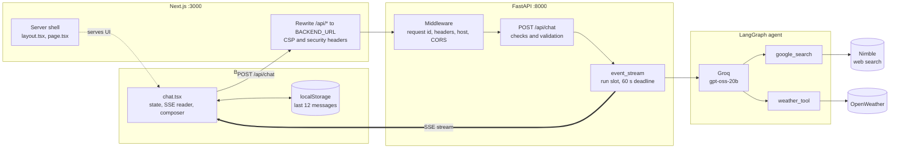
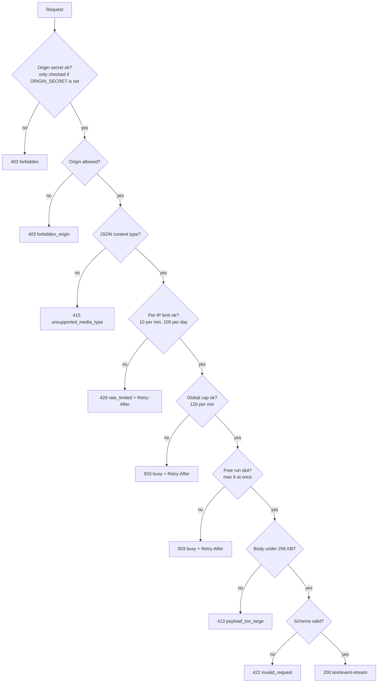
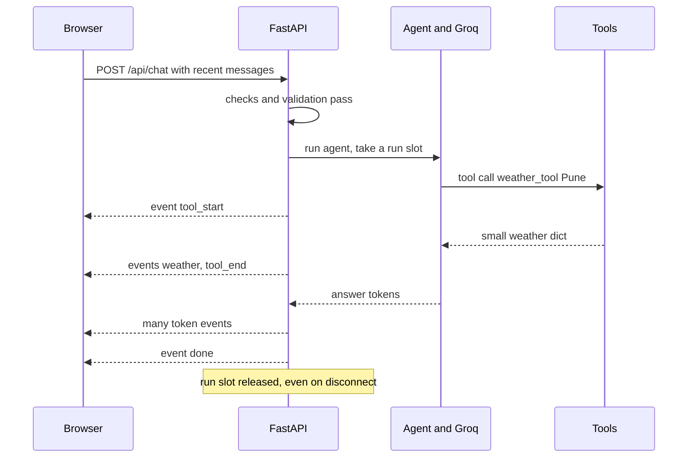

<div align="center">

# 🪺 QueryNest

**Ask anything. Get cited answers and live weather, streamed as they're written.**


<!-- [](LICENSE) -->
[](https://github.com/astral-sh/uv)


<!-- [Quickstart](#quickstart) · [Architecture](#architecture) · -->

</div>

----

### LIVE DEMO :https://querynest-one.vercel.app/
----


----
<!-- Add a screenshot or a 10-second GIF here: docs/demo.gif (a README with a visual converts far more visitors) -->

QueryNest is a research assistant that searches the live web and checks real-time weather, then answers with
numbered sources. A **Next.js** interface streams the response token by token while a **FastAPI** backend runs a
**LangChain / LangGraph** agent on **Groq** (`openai/gpt-oss-20b`), with **Nimble** (search) and **OpenWeather**
(weather) as its two tools. Python is managed with **uv**.

It started as a ~40-line Streamlit demo and was rebuilt as a small, hardened, production-shaped app: a streaming UI,
strict input validation, layered rate limiting, cost caps, and no secrets in the browser.

>### **The rate limiter is in-process** As it deployed on free hosting service ,So may take 50 sec to wake the api

## Highlights

| | |
|---|---|
| ⚡ **Streaming** | Server-Sent Events: tool activity, weather card, sources, then the answer as it is written |
| 🔎 **Cited answers** | Numbered sources `[1] [2]` that link to the pages the answer came from |
| 🌦️ **Weather cards** | Temperature, feels-like, humidity and wind in a clean card, in °C |
| 🛡️ **Secure by default** | Per-IP and global rate limits, Origin check, strict schema, security headers, safe markdown |
| 💸 **Cost-aware** | Concurrency cap, token cap, tool-loop cap, hard 60 s deadline |
| 🎨 **Polished UI** | Light/dark mode, keyboard shortcuts, stop / retry / copy, mobile layout, accessible |
| 🧩 **Small** | About 15 source files, two runtime services, no database |

## Architecture

### System overview



The browser only ever talks to the Next.js origin. The backend URL and every API key stay on the server, and the
backend keeps no per-user state: the browser sends the last 12 messages with each request.

### Request pipeline: every gate, in order

Checks run cheapest first, so abusive traffic costs almost nothing. Each rejection has a test.



Underneath the route, three middlewares wrap every response (outermost first): `RequestContextMiddleware`
(request id and security headers) → `TrustedHostMiddleware` → `CORSMiddleware`.

### One answer, end to end



### How agent output becomes UI events

`run_agent` streams LangGraph in two modes at once and maps message types to SSE events. It matches on message
classes rather than graph node names, so it survives internal renames.

| LangGraph stream | Condition | SSE event |
|---|---|---|
| `messages` | `AIMessageChunk` with visible text | `token` |
| `updates` | `AIMessage` carrying `tool_calls` | `tool_start` per call |
| `updates` | `ToolMessage` from `weather_tool`, no error | `weather` |
| `updates` | `ToolMessage` from `google_search` with http(s) results | `sources` |
| `updates` | any `ToolMessage` | `tool_end` |
| end of stream | | `done` |

### Components

| Component | File | Responsibility |
|---|---|---|
| API gateway | `backend/main.py` | Settings, rate limiter, schemas, middleware, `/api/chat`, `/api/health`, SSE pump with deadline |
| Agent and tools | `backend/agent.py` | Cached agent (`lru_cache`), `google_search`, `weather_tool`, result normalizer, event mapper |
| Chat client | `frontend/components/chat.tsx` | Message state, SSE reader, per-frame token batching, abort, retry, persistence, composer |
| Presentational UI | `frontend/components/cards.tsx` | Weather card, source list, tool chips, safe markdown, error notice with countdown |
| Edge config | `frontend/next.config.ts` | CSP and security headers, `/api` rewrite, `compress: false` so streams are not buffered |
| Origin lock (optional) | `frontend/middleware.ts` and `backend/main.py` | When `ORIGIN_SECRET` is set, the proxy attaches `x-origin-secret` and the API refuses chat requests without it |

### Tools

| Tool | Does | Guards |
|---|---|---|
| `google_search` | Runs Nimble in a worker thread, returns up to 5 `{id, title, url, snippet}` | 30 s timeout, snippets clipped to 800 chars, only http(s) links kept, citation ids stay unique across several searches, errors become `{"error": ...}` |
| `weather_tool` | Calls OpenWeather with `units=metric`, returns six fields plus icon | `params=` (URL-encoded), 8 s timeout, city validated (1 to 80 chars, no control characters), key never logged |

### What happens when something fails

| Failure | Behavior |
|---|---|
| Search times out or errors | Tool returns an error dict; the model tells the user instead of guessing |
| City not found or weather service down | `{"error": ...}` to the model, no weather card |
| Groq or agent raises | SSE `error` event with `code: internal` and a request id; details only in server logs |
| Run exceeds 60 s | SSE `error` event with `code: timeout` |
| Agent loops on tools | Recursion limit (10) stops it; SSE `error` with `code: limit` |
| Browser disconnects mid-answer | The stream is cancelled and the run slot is released by `async with` |
| Stream drops without `done` | UI shows a retryable "connection interrupted" notice |
| Limit hit | UI shows a live countdown from `Retry-After` |

### Trust boundaries

| Input | Treated as |
|---|---|
| Browser request (body, headers, `X-Forwarded-For`) | Untrusted: validated, size-limited, rate-limited; the forwarded IP is ignored unless `TRUST_PROXY=true` |
| Web search results | Untrusted data: trimmed, link-filtered, and the system prompt forbids following instructions inside them |
| Model output | Untrusted text: markdown without raw HTML, http(s) links only, images dropped |
| Environment variables | Trusted: validated at startup, the server refuses to boot if keys are missing |

## Quickstart

**Requirements:** [uv](https://docs.astral.sh/uv/), Node 20+, and API keys for [Groq](https://console.groq.com), Nimble and OpenWeather.
uv installs and pins the right Python (`backend/.python-version`), so you do not need to manage it yourself.

```bash
# install uv once: macOS/Linux
curl -LsSf https://astral.sh/uv/install.sh | sh        # or: brew install uv   |   pip install uv
# Windows (PowerShell): powershell -ExecutionPolicy ByPass -c "irm https://astral.sh/uv/install.ps1 | iex"

git clone https://github.com/adidongre006/querynest.git && cd querynest

# 1. Backend
cd backend
uv sync                                  # creates .venv and installs from pyproject.toml / uv.lock
cp .env.example .env                     # add GROQ_API_KEY, NIMBLE_API_KEY, OPEN_WEATHER
uv run pytest -q                         # green before you continue
uv run uvicorn main:app --reload --port 8000

# 2. Frontend (second terminal)
cd frontend
cp .env.example .env.local
npm install
npm run dev                              # open http://localhost:3000
```

Try the API directly (`-N` turns off curl's buffering so you can watch the stream):

```bash
curl -N -X POST http://127.0.0.1:8000/api/chat \
  -H "Content-Type: application/json" \
  -d '{"messages":[{"role":"user","content":"Weather in Pune"}]}'
```

### Working with uv

| Task | Command |
|---|---|
| Install everything (incl. dev group) | `uv sync` |
| Production install, no test tools | `uv sync --no-dev` |
| Run a command in the environment | `uv run <cmd>` |
| Add a dependency | `uv add <package>` |
| Add a dev-only dependency | `uv add --dev <package>` |
| Upgrade all dependencies | `uv lock --upgrade` |

Commit `backend/uv.lock` (generated by the first `uv sync`) and `frontend/package-lock.json` (generated by `npm install`)
so every machine and CI run installs identical versions.

## Security

Every row has either a test or a config line behind it.

| Threat | Defense |
|---|---|
| **Cost abuse** | Per-IP limits (10/min, 100/day), global cap, concurrency limit, token cap, tool-loop cap, 60 s deadline |
| **Malformed or huge input** | Strict Pydantic schema (`extra="forbid"`), 256 KB streamed body limit, length caps |
| **Bypassing the proxy** | Optional `ORIGIN_SECRET`: the API only serves `/api/chat` requests carrying the shared secret (constant-time compare), so forged `X-Forwarded-For` from direct calls is useless |
| **Cross-site abuse** | `Origin` check (403), CORS allowlist (never `*`), JSON-only content type, same-origin proxy |
| **Spoofed client IP** | `X-Forwarded-For` ignored unless `TRUST_PROXY=true` (covered by a test) |
| **Leaked secrets** | Keys live only in backend env; none in `NEXT_PUBLIC_*`; the weather key is never logged (httpx logger muted, no exception text logged) |
| **XSS** | No raw HTML in markdown, `http(s)` links only, images dropped, strict CSP |
| **Clickjacking and sniffing** | `X-Frame-Options`, `frame-ancestors`, `nosniff` |
| **Prompt injection** | Tool output declared untrusted; the model never holds keys; output only ever rendered as text |
| **Information leaks** | Generic client errors plus a request id; stack traces only in server logs; no message content or IPs in logs |

Found a vulnerability? Please open a private security advisory on GitHub instead of a public issue.

## Design decisions

| Decision | Why |
|---|---|
| **Stateless backend** | The browser sends the last 12 messages each time. No per-user server memory means no leak, no sticky sessions, trivial scaling. |
| **SSE, not WebSockets** | The stream is one-way. SSE is plain HTTP and needs no special server or proxy support. |
| **`/api` rewrite through Next.js** | One origin for the browser: no CORS in production, and the backend URL and keys never reach the client. |
| **Pure ASGI middleware** | `BaseHTTPMiddleware` interferes with streaming and disconnect handling, so request context is a small ASGI class. |
| **Hand-written rate limiter** | About 30 lines, no dependency, unit-tested maths, exact `Retry-After`. Trade-off: per-process (see limitations). |
| **Tools return tiny dicts** | Trimmed results cut tokens and avoid leaking upstream payloads. |
| **Deep search off by default** | Nimble deep search can take minutes; a chat UI needs seconds. One env var turns it on. |
| **uv for Python** | One fast tool for the virtualenv, lockfile and Python version; `uv sync` reproduces the exact environment. |

## API reference

<details>
<summary><b>POST /api/chat</b></summary>

Request:

```json
{ "messages": [ { "role": "user", "content": "Weather in Pune" } ] }
```

Rules: 1 to 12 messages, role `user` or `assistant`, user text 1 to 4000 chars (assistant 1 to 8000), last message from `user`, no extra fields, `Content-Type: application/json`, body under 256 KB.

Response: `text/event-stream`

| event | data |
|---|---|
| `tool_start` | `{"name":"weather_tool","input":"Pune"}` |
| `tool_end` | `{"name":"weather_tool"}` |
| `weather` | `{"city","country","temp_c","feels_like_c","humidity","wind_kmh","description","icon"}` |
| `sources` | `[{"id":1,"title":"...","url":"https://..."}]` |
| `token` | `{"text":"..."}` |
| `done` | `{}` |
| `error` | `{"code":"timeout\|limit\|internal","message":"...","request_id":"..."}` |

Failures before the stream starts are JSON, `{"error":{"code","message","request_id"}}`, with status
`403`, `413`, `415`, `422`, `429` or `503`. `429` and `503` include a `Retry-After` header.

</details>

<details>
<summary><b>GET /api/health</b></summary>

Returns `{"status":"ok"}`. Use it for platform health checks.

</details>

## Configuration

<details>
<summary><b>Backend environment variables</b> (<code>backend/.env</code>)</summary>

| Variable | Default | Purpose |
|---|---|---|
| `GROQ_API_KEY`, `NIMBLE_API_KEY`, `OPEN_WEATHER` | required | The server refuses to start without them |
| `ENV` | `development` | `production` disables `/docs` and `/openapi.json` |
| `ALLOWED_ORIGINS` | `http://localhost:3000,http://127.0.0.1:3000` | CORS allowlist and Origin check |
| `ALLOWED_HOSTS` | `localhost,127.0.0.1` | Accepted `Host` headers (`*.example.com` works) |
| `TRUST_PROXY` | `false` | Read the client IP from `X-Forwarded-For`; only behind a proxy that overwrites it |
| `ORIGIN_SECRET` | empty (off) | If set, `/api/chat` requires header `x-origin-secret` with this value |
| `RATE_LIMIT_PER_MINUTE` / `RATE_LIMIT_PER_DAY` | `10` / `100` | Per IP |
| `GLOBAL_LIMIT_PER_MINUTE` | `120` | All visitors combined |
| `MAX_CONCURRENT_RUNS` | `8` | Simultaneous agent runs before `503` |
| `RUN_TIMEOUT_SECONDS` | `60` | Hard cap per answer |
| `MAX_OUTPUT_TOKENS` | `2048` | Includes the reasoning model's thinking tokens |
| `AGENT_RECURSION_LIMIT` | `10` | Caps tool-call loops |
| `NIMBLE_DEEP_SEARCH` | `false` | Deeper but slower; raise both timeouts if enabled |
| `SEARCH_TIMEOUT_SECONDS` | `30` | Per search call |

</details>

<details>
<summary><b>Frontend environment variables</b> (<code>frontend/.env.local</code>)</summary>

| Variable | Purpose |
|---|---|
| `BACKEND_URL` | Where Next.js forwards `/api/*`. Server-only. Needed at **build time** (rewrite) and **runtime** (middleware) |
| `ORIGIN_SECRET` | Optional. Same value as the backend; activates `middleware.ts` |

</details>

## Project structure

```
querynest/
├── backend/
│   ├── main.py            middleware, rate limiter, validation, /api/chat (SSE), /api/health
│   ├── agent.py           tools, agent, streaming generator
│   ├── test_main.py       pytest suite (agent mocked: no keys or network needed)
│   ├── pyproject.toml     dependencies and dev group (uv.lock is generated)
│   ├── .python-version    Python version uv installs
│   └── .env.example
├── frontend/
│   ├── app/               layout.tsx, page.tsx, globals.css
│   ├── components/        chat.tsx (state, SSE reader, UI), cards.tsx (weather, sources, markdown, errors)
│   ├── next.config.ts     security headers and the /api rewrite
│   ├── middleware.ts      optional: attaches ORIGIN_SECRET when proxying /api
│   └── package.json, tsconfig.json, postcss.config.mjs, .env.example
├── .github/workflows/ci.yml  ## not implemented yet 
├── render.yaml            Render Blueprint for the backend
├── GUIDE.md               ELI5 walkthrough of every component
└── LICENSE
```

## Testing

```bash
cd backend  && uv run pytest -q                  # validation, 429 + Retry-After, spoofed IPs, headers, SSE order, 503, no error leaks
cd frontend && npm run typecheck && npm run build
```

CI runs both on every push and pull request.

## Deployment

<!-- The backend runs on **Render**, the frontend on **Vercel**. The full walkthrough, with verification commands, free-tier
caveats and troubleshooting, is in **[DEPLOYMENT.md](DEPLOYMENT.md)**. The short version: -->

1. Commit `backend/uv.lock` and `frontend/package-lock.json`.
2. **Render** Web Service Root Directory `backend`,
   Build `pip install uv && uv sync --frozen --no-dev`, Start `uv run --no-sync uvicorn main:app --host 0.0.0.0 --port $PORT`,
   Health Check `/api/health`. Set `PYTHON_VERSION`, `ENV=production`, `TRUST_PROXY=true`, `ALLOWED_HOSTS`, `ALLOWED_ORIGINS`,
   the three API keys, and `ORIGIN_SECRET`.
3. **Vercel**: Root Directory `frontend`, set `BACKEND_URL` and `ORIGIN_SECRET`, deploy.
>### 4. Put the Vercel URL into `ALLOWED_ORIGINS` on Render, then verify streaming and the rate limit.

<details>
<summary><b>Troubleshooting</b></summary>

| Symptom | Likely cause |
|---|---|
| Answer appears all at once | A proxy is buffering. Keep `compress: false`, keep `X-Accel-Buffering: no`, and test with `curl -N` against both ports |
| Everyone shares one rate-limit bucket | `TRUST_PROXY` is off behind a proxy, so all requests look like one IP |
| Rate limit is easy to bypass | `TRUST_PROXY=true` but nothing in front overwrites `X-Forwarded-For` |
| `403 forbidden_origin` | Your frontend URL (including preview deployments) is missing from `ALLOWED_ORIGINS` |
| `400 Invalid host header`, or failing health checks | Add the host your platform uses to `ALLOWED_HOSTS` |
| No sources shown | The search tool returned a shape the normalizer does not know; log the raw value in `agent._normalize` and extend it |
| Reasoning text shows up in answers | Print one streamed chunk and see where your `langchain-groq` version puts reasoning; only `text` blocks should be emitted |
| Answers get cut off | Raise `MAX_OUTPUT_TOKENS` (reasoning tokens count against it) |
| `uv: command not found` | Install uv (see Quickstart) and reopen your terminal |

</details>

## Known limitations

- **The rate limiter is in-process.** Several workers or instances each keep their own counters. Use Redis if you scale out.
- **IP-based limits are blunt.** Users behind one NAT share a bucket and attackers can rotate IPs. Add auth or a CAPTCHA (for example Cloudflare Turnstile) when you need more.
- **The CSP allows inline scripts**, because Next.js needs them to hydrate. Per-request nonces are the stricter upgrade.
- **Answers are only as good as the search results**, and language models can still make mistakes. Check the sources.


## Contributing

Issues and pull requests are welcome. Please run `uv run pytest -q` and `npm run typecheck` before opening a PR,
and keep changes small and focused.

## License

[LICENCE](LICENSE)